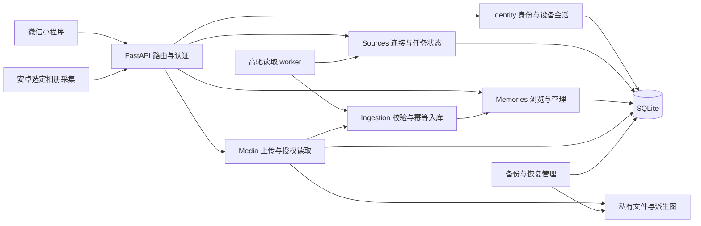

# 抱布记架构演进与开发计划 v0.2

日期：2026-10-28。状态：建议方案，基于 `2d57fa0` 审查。接口、表和任务均为拟议增量，不能视为已存在。

## 1. 技术决策

继续采用原生微信小程序、Python FastAPI、SQLAlchemy 与 SQLite。主服务按业务边界组织，来源采集和媒体处理在独立进程执行，最初用 systemd 调度。当前个人规模无需微服务、Kubernetes、Redis 或专门消息系统；它们会增加凭据、备份与故障面的管理成本。

SQLite 保留的前提是单机、有限写并发和可验证恢复。将 schema 版本、写事务耗时、锁冲突、备份时长作为演进证据。出现持续写锁竞争、跨主机部署或恢复窗口无法满足时，再评估 PostgreSQL；数据库接口抽象不应假装现有 `BEGIN IMMEDIATE` 能直接移植。

照片先用受控私有文件存储加稳定 storage key；是否换私有对象存储依据容量和运维成本再定。API 层不直接返回本地路径，便于以后迁移。估算容量使用“照片数 × 原图均值 + 派生图 + 保留备份”，以实际采样统计替代未经验证的云盘余量。

## 2. 目标模块和依赖

这是目标结构，不是当前部署图。

| 模块 | 职责 | 不承担的职责 |
|---|---|---|
| Identity | 账户、外部身份验证、绑定、会话、设备撤销 | 不持有高驰业务授权，不控制回忆展示 |
| Sources | 来源连接、授权状态、范围、调度意图、任务租约 | 不直接拼接 UI 文案，不判断微信身份 |
| Ingestion | 标准化候选、校验所有者、抑制、幂等、来源版本 | 不调用未知网络地址、不自行接受客户端 user_id |
| Memories | 列表、详情、备注、可见性、删除、偶遇 | 不解析供应商协议、不读凭据文件 |
| Media | 上传会话、内容校验、文件状态、缩略图、访问授权 | 不把原始文件公开映射为静态目录 |
| Legacy | 旧账单/健身读取、兼容导出与必要维护 | 不继续成为新产品首页中心 |
| Operations | 迁移、备份恢复、部署、状态指标 | 不把真实数据或配置写入代码仓库 |

建议逐步把 `routers/memories.py` 中事务业务迁入 service，先迁与新功能相关部分。不要一次性重排整个项目目录；测试导入方式也要随包结构调整，避免大范围机械搬迁。

## 3. 数据模型增量

### 3.1 第一批：连接与任务

`source_connections`：`id, user_id, provider, external_subject_digest?, credential_ref, status, generation, scope_config, created_at, updated_at`。

- credential_ref 只存受控引用，明文令牌留在服务账号私有凭据存储；数据库备份和凭据备份分别制定恢复策略。
- 一名用户首版每个 provider 只允许一个活动连接，之后按需要扩展多账户；所有来源 ID 的唯一性须绑定连接作用域。
- `generation` 在暂停、断开、重新绑定或范围调整时递增，在途任务提交前重新检查。
- 来源账户摘要可得性尚待验证；不可得时不允许自动认定重授权后还是同一账户。

`sync_runs`：`id, connection_id, requested_range, state, started_at, completed_at, error_code, received_count, inserted_count, updated_count, suppressed_count, lease_owner, lease_expires_at, fencing_token`。

`sync_coverage`：明确成功处理的区间、数据种类、完整性与上游限制；不能只用“最近成功日期”表示全部历史。初期可每段一行，不预先建设通用工作流引擎。

外部请求应在短写事务外执行，写入前验证连接代次、租约与用户归属。锁续期和 token 刷新串行单独设计，避免网络阻塞占用 SQLite 写锁。凭据目录锁继续保护同份 token，连接租约解决不同进程/目录重复任务。

### 3.2 第二批：回忆元数据

在现有 Memory 上最小增加：`kind, connection_id?, source_revision?, source_updated_at?, captured_at?, time_precision, original_timezone?, title?, user_note?, discoverable, created_at, updated_at`。

- `occurred_at` 继续统一 UTC 和精度；对只有日期的素材保存日期精度，不凭空生成“准确时刻”。照片未知时间按独立标识呈现。
- 来源内容和用户笔记独立，重复同步只更新允许更新的来源字段。供应商删除是否映射为本地删除默认否，需独立定义。
- 标准化候选包含 provider、来源键、发生时间、类型、必要结构化摘要及版本；供应商原始大包默认不长期保存。
- 高驰摘要应保留运动类型和实际需要的距离、时长等字段，避免只留标题后无法解释记录或获取详情。
- 索引候选 `(user_id, hidden, occurred_at, id)`，由合成数据与 `EXPLAIN QUERY PLAN` 验证后添加；不要仅凭命名判断索引有效。

删除抑制逐步迁移为连接作用域，包含删除时间和来源键。默认导入合并当前抑制，不让旧快照撤回后来删除意图；灾难恢复需要定义删除记录的备份与可能损失窗口。

### 3.3 第三批：媒体与设备

`media_assets`：所有者、回忆 ID、storage key、内容散列、大小、真实 MIME、尺寸、处理状态、派生图引用、元数据策略、创建时间。

`upload_sessions`：所有者、设备/连接、幂等键、预期散列与长度、状态、到期时间、同步范围代次。

`devices/device_sessions`：用户、设备标识、可撤销凭据摘要、权限范围、上次使用、到期与撤销状态。安卓不能长期使用无范围的账号 JWT 上传；初始方案可由已认证账户生成短时一次性配对凭据，兑换为仅所需权限的设备会话。绑定、失效、重放和撤销必须测试。

现有照片计划按 `(album_id,item_id)` 识别不足以覆盖跨设备、重装或移动相册。设备来源身份和内容散列分别记录，移动相册不一定等同新素材；范围变更先服从用户选择，再处理去重。

### 3.4 迁移原则

选定一种版本化迁移机制（建议 Alembic，正式采用前核对当前官方用法及 SQLite 批量变更约束），记录数据库 schema 版本。`create_all` 可用于新建隔离库，不再担当生产迁移。

每次迁移包含：旧结构样本 → 备份 → 升级 → 数据/约束检查 → 新旧版本兼容检查 → 失败处理。新增列先可兼容读取，回填后再收紧约束。保留旧表和历史数据，不能将代码入口删除误当成数据删除授权。

## 4. 拟议 API 契约

先在文档及 OpenAPI 固定结构，再实现。当前列表返回裸数组，修改必须通过新版本路径或明确协商，不能让旧小程序收到不兼容结构。

| 接口候选 | 行为及权限 | 关键验收 |
|---|---|---|
| `GET /api/capabilities` | 最小公开能力与协议版本；不含配置/秘密 | 功能关闭时页面不引导失败操作 |
| `GET /api/me` | 当前账户和已绑定登录身份摘要 | 服务端事实，不返回 openid/密钥 |
| `POST /api/auth/logout` | 撤销当前新式会话 | 退出后旧 token 后续请求失败 |
| `POST /api/auth/logout-all` | 重新确认身份后撤销全账户会话 | 两设备和在途语义明确 |
| `GET /api/sources` | 当前用户连接、范围、同步状态 | 不返回凭据路径、来源原始身份 |
| `POST /api/sources/{id}/sync-runs` | 请求有限范围任务，返回 202/run ID | 幂等、配额、重复点击合并 |
| `PATCH /api/sources/{id}` | 暂停/恢复或范围设置 | 修改代次，旧任务不能提交 |
| `DELETE /api/sources/{id}` | 断开连接；保留内容为默认 | 后续调度和凭据使用均停止 |
| `GET /api/v2/memories` | 用户过滤、来源/类型/日期、游标 | `items,next_cursor,has_more`；上限 100 |
| `GET /api/memories/{id}` | 自有详情 | 非本人和不存在统一 404 |
| `POST /api/memories` | 手工文本与备注；来源服务端确定 | 幂等键避免重试重复 |
| `PATCH /api/memories/{id}` | 备注、隐藏、是否偶遇；限制可编辑字段 | 不允许改所有者或冒充来源 |
| `DELETE /api/memories/{id}` | 移除并保存抑制/媒体清理任务 | 重试可幂等，普通同步不复活 |
| `POST /api/memories/discover` | 完整历史中产生候选，排除集合有上限 | 不限首批 50 条，不泄露他人 ID |
| `POST /api/media/uploads` | 建上传会话和额度检查 | 身份、类型、大小、幂等 |
| `PUT /api/media/uploads/{id}/content` | 有界流式写入暂存 | 校验长度/散列，不占长期 DB 写锁 |
| `POST /api/media/uploads/{id}/complete` | 校验处理并最终提交 | 失败不显示，重复提交返回同一结果 |
| `GET /api/media/{id}` | 认证后返回指定派生图或文件 | 所有者检查、私有缓存策略 |
| `POST /api/data/import/preview` | 校验版本、范围、冲突和预计变更 | 不修改数据，不把未知字段当成可信来源 |
| `POST /api/data/import/commit` | 提交明确模式的预览 | 预览版本过时拒绝或重新预览 |

来源授权流程另需 initiation/callback 或设备授权协议，取决于核验后的官方能力；防止账户串绑，保存短期状态并校验授权发起者。不要为填满接口表而虚构上游 OAuth 行为。

所有请求具有限长、固定业务错误码、适当的 HTTP 状态和 request ID。客户端保留 status/code/retry_after，不再把所有异常压成一条字符串。上游原始错误不直接展示。

游标至少包含时间与 ID，绑定过滤条件并严格校验。首版承认持续更新下非固定快照；时间被修正或补入较老记录时通过刷新补齐，不能声称任意并发下绝对无遗漏。

## 5. 照片处理与一致性

建议流水线：授权范围与配额校验 → 创建 upload session → 暂存文件 → 检查真实格式/尺寸/解码资源 → 按策略剥离敏感元数据 → 生成缩略图 → 原子移入私有最终目录 → DB 事务关联回忆并标 ready → 返回提交结果。

文件与 DB 不能共用原子事务，因此须保存 `staging/processing/ready/failed/deleting` 状态。崩溃恢复扫描超时暂存、无引用最终文件和缺失文件记录，采取可重试对账；只有 ready 可进入列表。删除先阻止读取，再异步清理文件与派生物，失败可重试。

前端图片认证方式先做微信真机小实验：优先认证下载至受控临时路径；若采用短时签名 URL，需短过期、限定对象/用途、禁止日志记录参数，并说明撤销前的有效窗口。不能把 bearer token 长期放进图片 URL。

默认位置关闭时，派生图剥离 GPS；若原图保留 GPS，也必须单独告知并获得相应选择，不能只隐藏地图。解码处理限制像素数、字节数和时间，避免单个文件耗尽进程资源。

## 6. 发布与恢复流程

1. **构建：** 固定提交、依赖、辅助程序版本；隔离测试、配置与包内容检查，输出脱敏发布清单。
2. **预检：** 核实实际服务用户、反代链、HTTPS、schema、磁盘和备份，不以开发机环境检查代替。
3. **恢复演练：** 从一致性快照创建隔离副本，核对关键字段/约束/业务不变量；B 阶段同时检查媒体清单与散列。
4. **变更窗口：** 停止或隔离写入 worker；按迁移兼容性决定是否停服务；记录迁移前备份与原发布版本。
5. **迁移与切换：** 显式迁移、只读校验，原子切换代码/配置版本，readiness 和认证隔离检查通过后开放。
6. **采集恢复：** 单次同步验证后再恢复定时任务，观察错误、积压及磁盘增长。
7. **回退：** 优先回退兼容代码；不可逆迁移应恢复副本并明确新增写入损失。恢复旧库必须防止旧会话/JWT 复活，保留身份 HMAC 可用性；停止持旧密钥服务。
8. **记录：** 写明代码 SHA、schema 版本、实际检查结果、回退材料和是否上传/审核/发布。

外部供应商暂不可用通常只影响采集，不应阻断读取已存回忆。媒体文件不随 Git 版本回滚；恢复必须按 manifest 对齐。真实发布按当次明确授权范围执行。

### 密钥、备份与威胁边界

JWT 签名密钥、身份摘要 HMAC、限流摘要密钥和来源 OAuth 凭据各有用途，建议独立配置与版本标识。身份 HMAC 丢失会使绑定无法解析，不能在灾难恢复时随意重建；轮换需新旧 key ID 和迁移验证。JWT 轮换则应使旧凭据失效，所有服务实例同步切换。长期来源凭据放在项目之外、专用账号可读的位置，备份加密密钥另行保管，不把“0700 目录”当作磁盘加密。

现有同机备份不能覆盖服务器整机丢失。建议至少一份加密异地副本或独立故障域副本，数据库、媒体 manifest 和可恢复密钥各有清单与保留期；每次演练从该副本实际恢复，不仅验证本机压缩包能解压。预算、保留期与恢复目标在真实媒体数量明确后落实。

基础威胁边界包括未登录访问、另一账户越权、遗失设备、复制令牌、供应商返回异常、文件上传滥用与运维误操作。当前方案不提供端到端加密：服务器运行账号仍能处理明文媒体。如果未来要求服务器也不能读取内容，需要单独研究客户端加密、密钥恢复和缩略图生成，不能在现架构上直接宣称具备该能力。

## 7. 任务分解与依赖

工作量是单开发者的粗粒度有效工作日估计，含对应测试，不含授权等待和未知平台故障；不是排期承诺。先完成每阶段验收再修订后续估计。

| 任务 | 对应问题/需求 | 交付与完成条件 | 依赖 | 估计 |
|---|---|---|---|---|
| T01 工程入口收敛 | F01～03、19、22、24 | 统一部署/备份入口；测试强隔离；前后端 CI；当前 README/导航；不动用户个人配置 | 无 | 2–3 天 |
| T02 数据生命周期 | F04、05、08、21；REQ-09/13/14 | 默认导入保留抑制；清空暂停意图；手写来源受限；导入预览规格及对应测试 | T01 | 2–4 天 |
| T03 客户端状态修复 | F06、07、18；REQ-01/10 | 请求代次、账户代次、401 清屏、乱序和分页交错测试 | T01 | 1–2 天 |
| T04 身份与能力契约 | F09、10；REQ-02/14 | me/capabilities、绑定事实与偏好分离、密码兼容、当前设备退出；微信协议核验 | T01、T03 | 3–5 天 |
| T05 来源与同步任务 | F13、14、17、23；REQ-03/04/05 | 版本迁移、连接状态、连接级租约/代次、覆盖区间、历史回填、状态 API | T01、T02 | 4–7 天 |
| T06 回忆可用体验 | F11、12、18；REQ-06/07/08/09 | 日期/详情、文字补记、管理、全历史偶遇、有界列表 | T02、T03、T04 | 3–5 天 |
| T07 A 阶段真实闭环 | F20；REQ-01～10/13 | 安全发布流程、恢复演练、重新授权、受控真实同步、客户端读取、连续试用记录 | T04～T06 | 3–5 天 + 观察期 |
| T08 媒体后端 | F15、17、21；REQ-12/13/15 | 上传状态机、格式/元数据策略、缩略图、认证读取、对账、媒体备份恢复 | T01、T02、T05 | 5–8 天 |
| T09 安卓可行性实验 | F16；REQ-11 | 在目标设备验证范围、未来新增、重启、权限撤销、后台限制，确定采集 API | 可在 T07 前做独立技术实验 | 2–3 天 |
| T10 安卓最小采集端 | F16；REQ-11/12/14 | 设备配对、持久队列、选定相册、暂停、重试、状态；未选相册零上传 | T08、T09 | 7–12 天 |
| T11 B 阶段照片闭环 | REQ-11～15 | 目标设备真实照片到小程序，EXIF/删除/断网/恢复测试，容量与耗电记录 | T08、T10 | 3–5 天 + 观察期 |
| T12 体验与来源扩展 | 后续需求 | 先评估是否满足低负担回忆，再选 FIT 路线或其他一个来源；共享另立规格 | T07；照片相关依赖 T11 | 单独评估 |

T02 中“清空暂停”需要 T05 的连接代次落地；T05 前先阻止没有安全语义的清空流程，不以临时布尔值假装解决在途提交。T04 的真实微信联调受平台访问条件约束，候选功能可先在隔离环境完善，不绕过该门槛启用生产。

建议一个任务一个可审查提交或小批次：记录问题、行为变化、测试、限制与部署状态。阶段结束做一次完整回归，日常用影响范围内测试；不要每次文案修改都重复全部昂贵联调。

## 8. 测试矩阵与上线门槛

| 类别 | 重点场景 | 对应阶段 |
|---|---|---|
| 身份 | 两账户隔离、绑定冲突、解绑与签发并发、当前/全部设备退出、旧 JWT 撤销、重新授权 | T04/T07 |
| 前端 | 乱序回包、刷新与分页交错、401、网络失败、换账号、退出、页面卸载、能力关闭 | T03/T06 |
| 同步 | 重复、来源更新、区间满额、单日满额、超时、格式变动、暂停时在途提交、租约过期、错误账户 | T05/T07 |
| 数据管理 | 旧 v2 导入不复活删除、清空后不自动重新收录、未知版本拒绝、预览后数据变化 | T02/T05 |
| 媒体 | 非图片伪装、超大像素、EXIF、断点/重传、提交响应丢失、崩溃对账、跨账户取图、删除失败 | T08/T11 |
| 安卓 | 未选范围、选后新增、移动相册、权限撤销、重启、系统限制后台、离线、重装去重 | T09～T11 |
| 运维 | 每个入口一致、WAL 快照、迁移故障、磁盘满、旧库恢复、密钥轮换、备份缺媒体、ready 503 | T01/T07/T11 |

所有自动测试只用虚构资料。真实联调限定所需来源、范围与动作，不把原始响应或照片复制到测试仓库。此前用户允许跳过手机测试属于历史选择，不能把未做过的测试标为已通过；本方案把目标设备验证列为照片后台可靠性验收的必要证据。

**A 阶段通过条件：** P0 问题已关闭；身份与跨账户隔离、删除抑制、同一来源的重复/失败恢复、真实摘要读取、可见同步状态和完整恢复演练均有证据。平台和生产条件未完成时保持隔离试用状态。

**B 阶段通过条件：** A + 选定相册范围无越界、媒体访问隔离、删除与撤销不复活、后台限制有诚实提示、数据库与媒体可一起恢复。不能只凭“上传成功一张图片”宣布照片同步完成。

## 9. 暂不投入的方向

复杂三维世界、AI 自动生成回忆叙事、向量库、跨来源自动人物识别、持续定位、双人共享和多个第三方非官方登录连接暂缓。它们分别引入性能、事实真实性、隐私授权或同步维护成本，应在真实素材和基础回看体验得到验证后单独论证。

## 10. 官方能力参考与复核限制

- [COROS 工具说明](https://github.com/coroslab/COROS-MCP/blob/main/docs/en/tools.md)：本次可读；活动查询按账户时区，FIT 工具存在且有配额，返回字段仍需真实契约验证。
- [COROS 连接说明](https://github.com/coroslab/COROS-MCP/blob/main/docs/en/getting-started.md)：本次可读；统一端点与地区回退均列出，不能未经测试硬切换。
- [COROS MCP 更新记录文章](https://www.coros.com/stories/coros-metrics/c/mcp-testing)：本次可读；FIT 和 GPS 能力取决于实际记录，不能解释为所有运动都含轨迹。
- [Android 部分照片权限](https://developer.android.com/about/versions/14/changes/partial-photo-video-access)、[目录访问](https://developer.android.com/training/data-storage/shared/documents-files)、[WorkManager](https://developer.android.com/develop/background-work/background-tasks/persistent)：本次可读；权限与后台行为仍须目标系统实测。
- [微信登录](https://developers.weixin.qq.com/miniprogram/dev/framework/open-ability/login.html)、[code2Session](https://developers.weixin.qq.com/miniprogram/dev/OpenApiDoc/user-login/code2Session.html)：本次正文访问失败；正式身份联调前重新核验，不宣称当前实现已获官方契约验证。

参考资料核查日期为 2026-10-28。规格中的架构取舍、性能目标和工作量为本轮工程建议，不是这些资料的保证。
